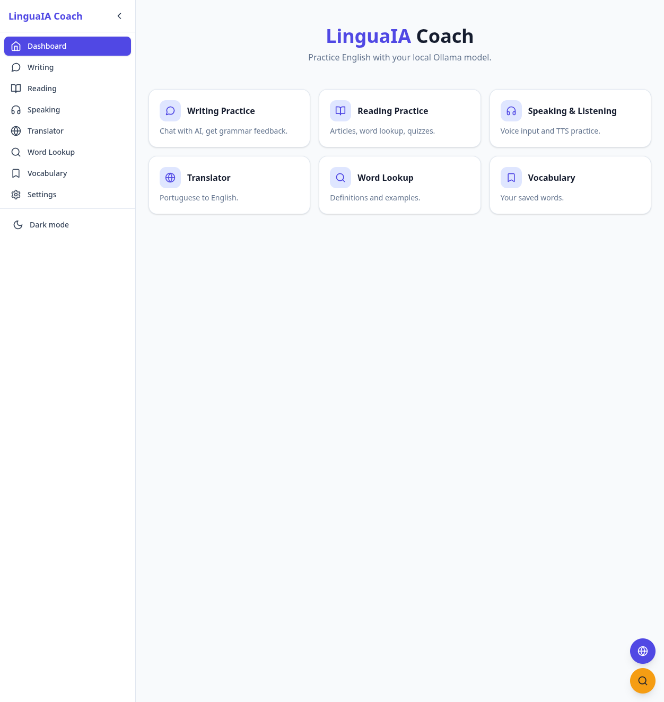
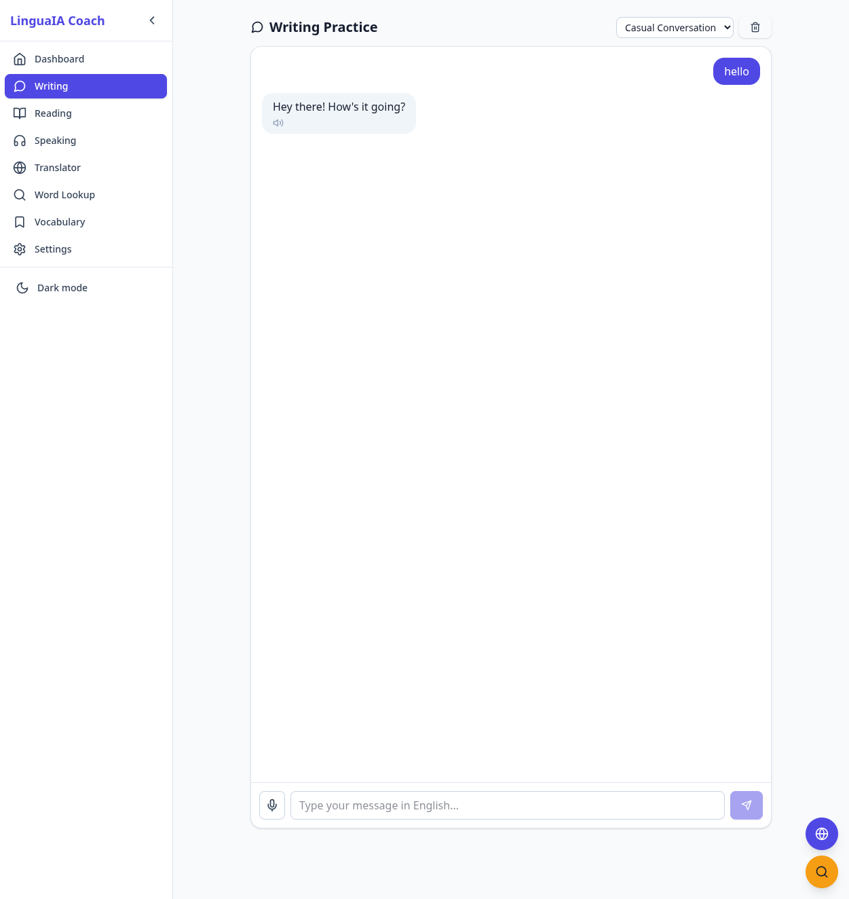
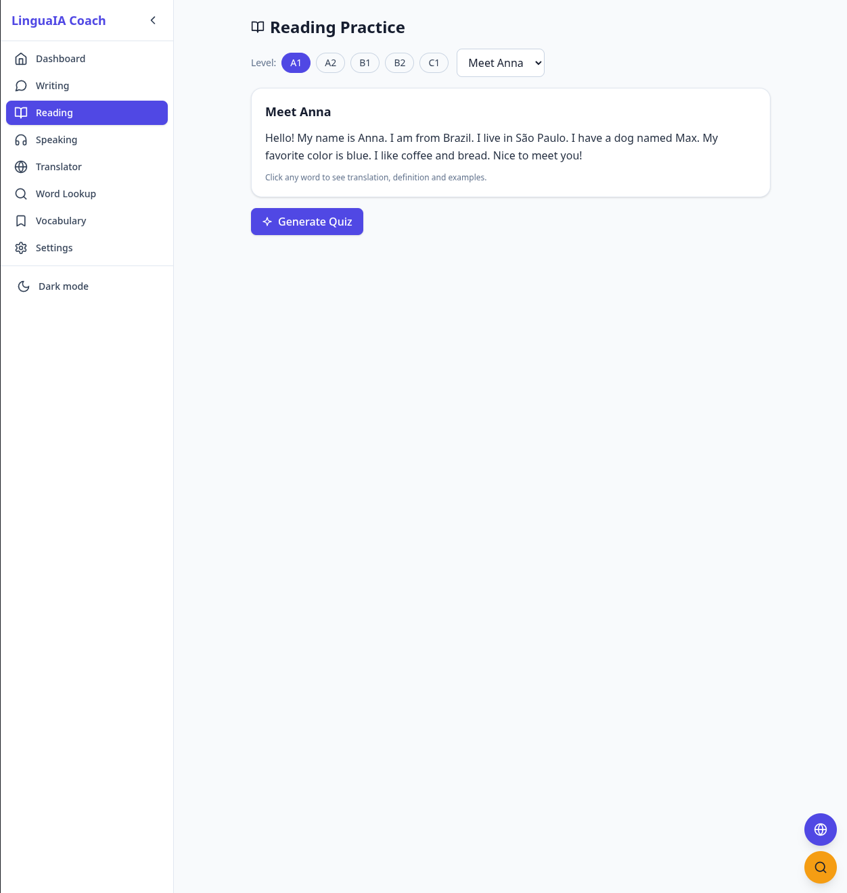
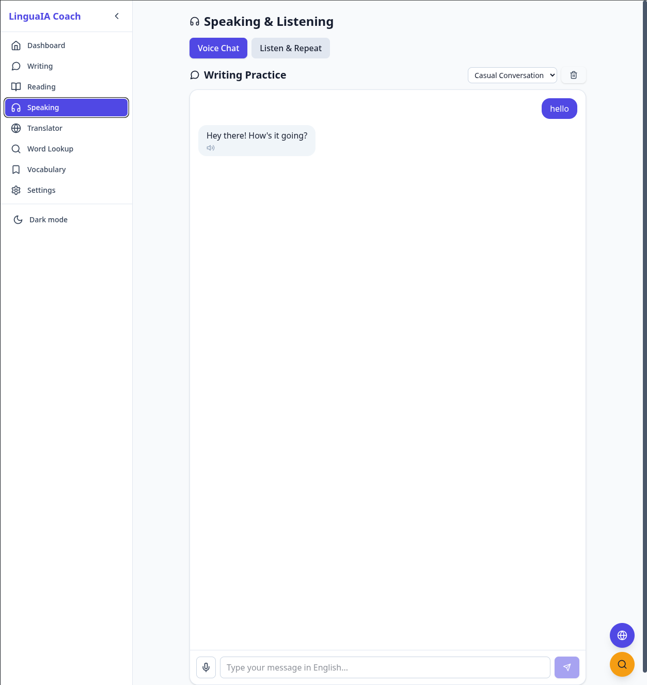
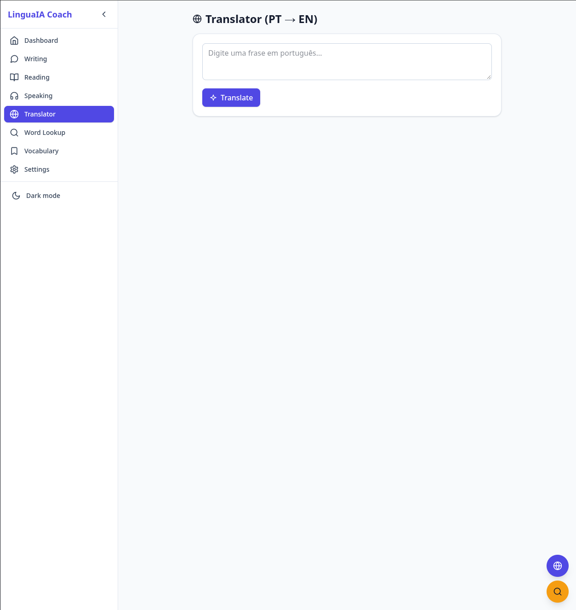
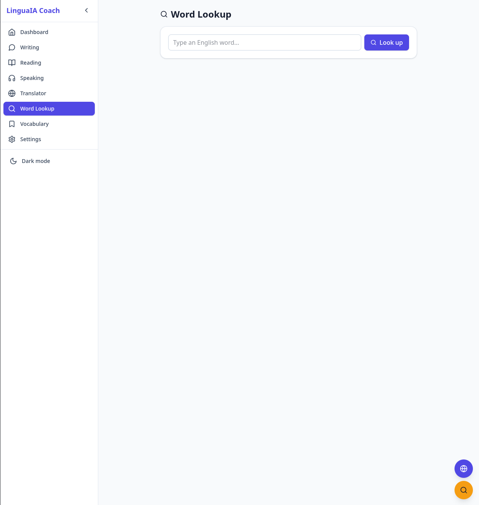
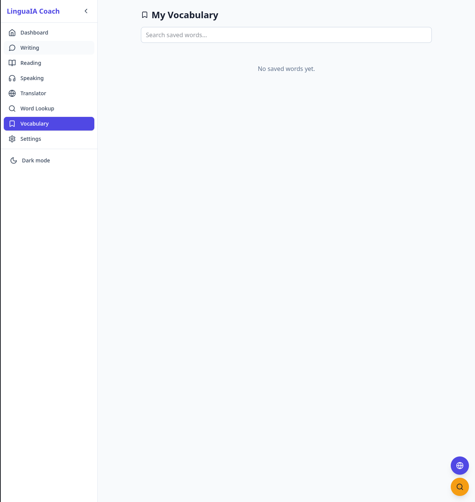
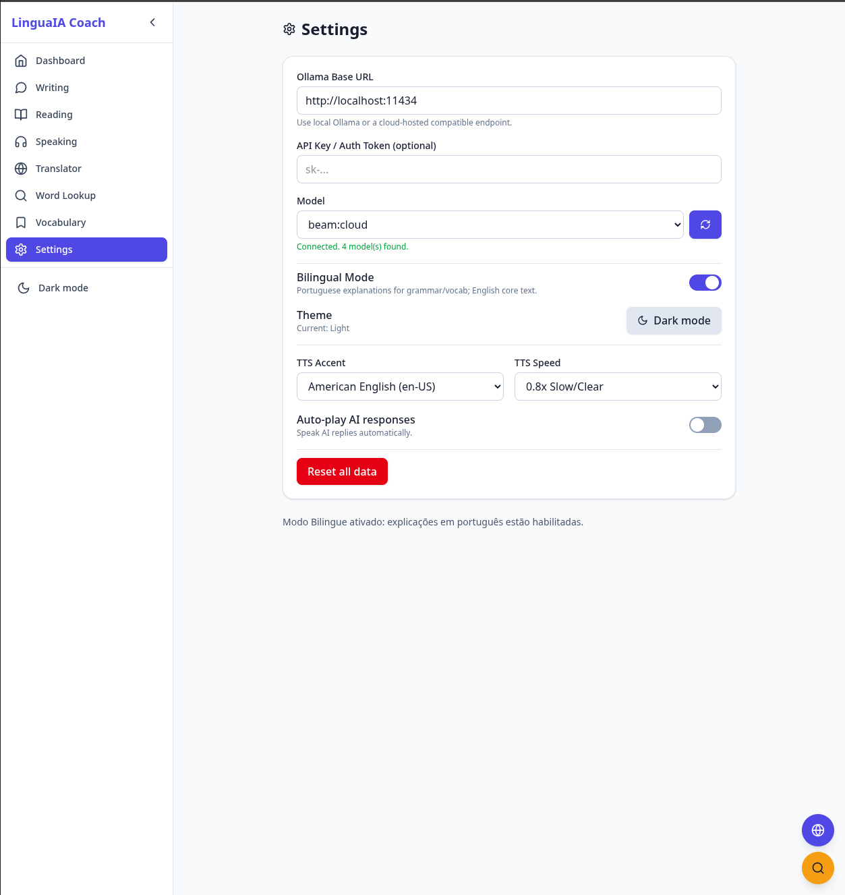
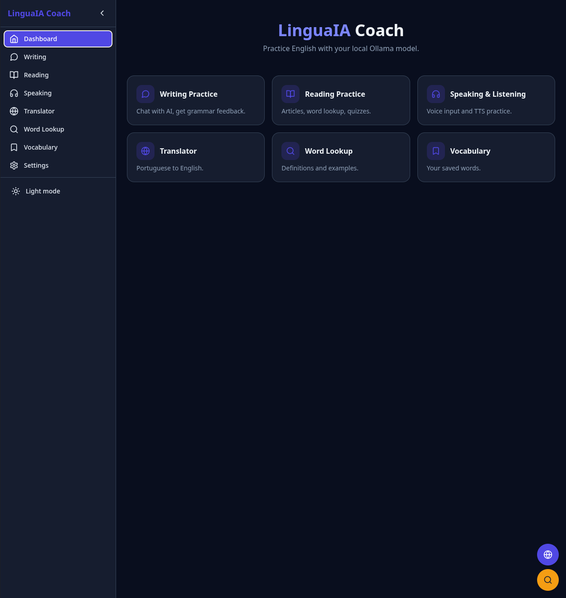

# 🌐 LinguaAI Coach

**LinguaAI Coach** é um aplicativo web completo (*Single Page Application* em arquivo único) projetado para o estudo interativo da língua inglesa com o suporte de inteligência artificial local ou em nuvem via **Ollama**.

O aplicativo roda 100% no seu navegador e oferece módulos para **prática de escrita (chat), leitura guiada, simulação de fala e escuta (speaking/listening), tradutor contextual e dicionário de vocabulário**, além de feedbacks gramaticais bilíngues (PT/EN) e armazenamento de progresso via `localStorage`.

---

## 📸 Screenshots

### 🏠 Dashboard Principal
<p align="center">
  
</p>

### ✍️ Writing Practice (Chat com IA) & 📖 Reading Practice
<p align="center">
  
  &nbsp;&nbsp;
  
</p>

### 🎙️ Speaking & Listening & 🌐 Tradutor (PT → EN)
<p align="center">
  
  &nbsp;&nbsp;
  
</p>

### 🔍 Dicionário & 📚 Vocabulário Salvo
<p align="center">
  
  &nbsp;&nbsp;
  
</p>

### ⚙️ Configurações & 🌙 Dark Mode
<p align="center">
  
  &nbsp;&nbsp;
  
</p>

---

## 📋 Sumário

* [Screenshots](#-screenshots)
* [Funcionalidades](#-funcionalidades)
* [Modelos Recomendados](#-modelos-recomendados)
* [Tecnologias Utilizadas](#-tecnologias-utilizadas)
* [Pré-requisitos](#-pré-requisitos)
* [Como Executar](#-como-executar)
* [Configuração de CORS no Ollama](#-configuração-de-cors-no-ollama)
* [Estrutura do Projeto](#-estrutura-do-projeto)
* [Licença](#-licença)

## ✨ Funcionalidades

### ⚙️ Settings & Conexão com Ollama

* Configuração de URL Base (Padrão: `http://localhost:11434`) e API Key/Token opcional.
* Dropdown dinâmico para seleção de modelos detectados via endpoint `/api/tags`.
* **Modo Bilíngue:** Conversa principal em inglês e orientações/explicações gramaticais detalhadas em português.
* **Modo Simulado (Offline):** Permite testar o app instantaneamente sem a necessidade de manter o servidor Ollama ativo.
* **Preferências de Áudio (TTS):** Escolha de sotaques (`en-US` / `en-GB`) e velocidade de reprodução ($0.8\text{x}$, $1.0\text{x}$, $1.2\text{x}$).

### 🌐 Tradutor & Dicionário Contextual

* **Tradutor PT → EN:** Digite frases em português e receba a tradução para o inglês natural acompanhada de justificativas gramaticais.
* **Busca de Palavras:** Exibe tradução em português, definição simples em inglês e 3 frases de aplicação no dia a dia.

### ✍️ Writing Practice (Chat com Tutor)

* Diálogo em tempo real com cenários configurados (*Job Interview*, *Ordering Coffee*, *Casual Chat*, *Airport Check-in*).
* Interface com resposta dupla: mensagem da IA em inglês e caixa de destaque com correções gramaticais em português.

### 📖 Reading Practice (Leitura Guiada)

* Biblioteca de textos curtos categorizados por nível (A1 a C1).
* **Vocabulário Interativo:** Clique em palavras do texto para abrir popovers com definições e traduções.
* Testes de compreensão com correção instantânea e explicações em português.

### 🎙️ Speaking & Listening (Prática Oral)

* Transcrição de voz em tempo real através da browser `SpeechRecognition` API.
* Leitura audível automática das respostas da IA com suporte aos controles de voz e velocidade.

## 📊 Modelos Recomendados

Comparativo compacto para ajudar você a escolher o modelo ideal no Ollama:

| Modelo | RAM/VRAM | Velocidade | Destaque / Ideal Para |
| ----- | ----- | ----- | ----- |
| **Qwen 2.5 7B** | \~4.7 GB | ⚡⚡ Rápido | 🌟 **Melhor escolha geral** (alta precisão gramatical em PT) |
| **Llama 3.2 3B** | \~2.0 GB | ⚡⚡⚡ Ultrarrápido | 🎙️ **Voz em tempo real** & PCs/GPUs mais modestos |
| **Llama 3.1 8B** | \~4.9 GB | ⚡⚡ Rápido | 💬 Conversa natural e expressões idiomáticas |
| **Gemma 2 9B** | \~5.4 GB | ⚡ Moderado | 📚 Explicações gramaticais detalhadas |

## 🧰 Tecnologias Utilizadas

* **React 18** (Carregado via CDN UMD)
* **Tailwind CSS v4** (Estilização responsiva via CDN)
* **Babel Standalone** (Transpilação JSX em tempo de execução no navegador)
* **Lucide Icons** (Ícones dinâmicos)
* **Web Speech API** (`SpeechRecognition` e `SpeechSynthesis` nativos)
* **Ollama REST API** (Endpoints `/api/tags`, `/api/generate` e `/v1/chat/completions`)

## 📋 Pré-requisitos

1. **Navegador Moderno:** Google Chrome, Microsoft Edge ou Brave (recomendados para suporte completo à Web Speech API).
2. **Instância do Ollama:** Instalado localmente ou hospedado na nuvem (<https://ollama.com>).
3. **Download do Modelo:** Execute no terminal do servidor:

```bash
# Para máxima velocidade em áudio:
ollama pull llama3.2:3b

# Para o melhor equilíbrio geral:
ollama pull qwen2.5:7b
```

## ▶️ Como Executar

### Opção A: Execução Direta (Sem Servidor Web)

1. Baixe o arquivo `index.html`.
2. Dê **dois cliques** no arquivo para abri-lo diretamente no seu navegador.

### Opção B: Servidor Local (Recomendado)

Para evitar restrições locais de scripts no navegador:

```bash
# Utilizando Python
python -m http.server 8080

# Ou utilizando Node.js
npx serve .
```

Em seguida, acesse `http://localhost:8080` no navegador.

## 🔌 Configuração de CORS no Ollama

Para que o aplicativo executado no navegador consiga se comunicar com a API do Ollama sem ser bloqueado por políticas de origem (CORS), configure a variável `OLLAMA_ORIGINS`:

### Linux / macOS

```bash
OLLAMA_ORIGINS="*" ollama serve
```

### Windows (PowerShell)

```powershell
$env:OLLAMA_ORIGINS="*"
ollama serve
```

> **Nota de Segurança:** Em ambientes de produção, substitua `*` pelo domínio exato onde o app estiver hospedado.

## 📁 Estrutura do Projeto

```
├── index.html     # Aplicação completa (UI React, Tailwind, Web Speech API e cliente Ollama)
├── README.md      # Documentação do projeto
├── LICENSE        # Licença MIT
└── screenshots/   # Imagens de demonstração da interface
    ├── tela-1.png
    ├── tela-2.png
    ├── tela-3.png
    ├── tela-4.png
    ├── tela-5.png
    ├── tela-6.png
    ├── tela-7.png
    ├── tela-8.png
    └── tela-9.png
```

## 📄 Licença

Distribuído sob a licença **MIT**. Consulte o arquivo `LICENSE` para mais detalhes.
